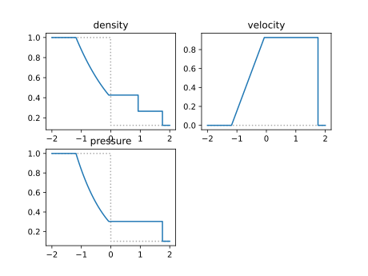
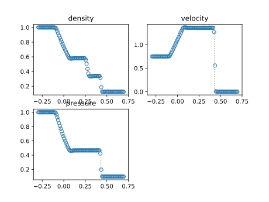

The Python script `riemann.py` solves analytically the Euler equations for compressible adiabatic ideal gas in one dimension starting from initial conditions of Riemann problems.

The Python script `fvm.py` solves numerically using finite-volume methods the Euler equations for compressible adiabatic ideal gas in one dimension starting from general initial conditions.

